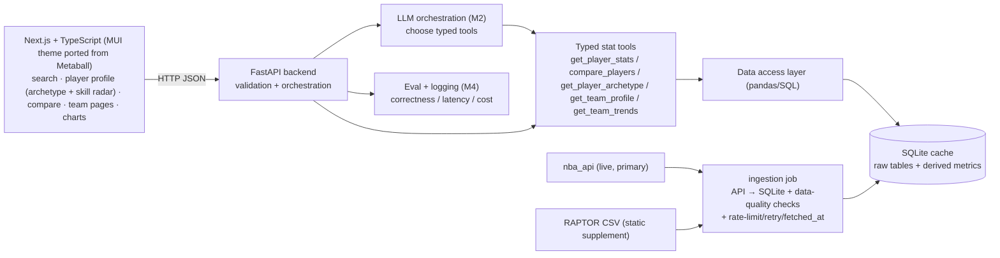

# CourtIQ — Design Doc (MVP)

| Field | Value |
|---|---|
| Doc owner | fzwang |
| Status | Draft — stack decisions signed off |
| Last updated | 2026-10-26 |
| Project | CourtIQ (built on the cloned `Metaball` repo) |
| Scope | MVP: interactive NBA analyst UI (player profile/compare/team pages) over grounded stats → tool-calling analyst |
| Source of intent | `courtiq_project_context.md` |
| Data source decision | `nba_api` (live, primary) → SQLite cache; RAPTOR CSV kept as static supplement (owner-confirmed) |
| Data store decision | SQLite now, Postgres later (owner-confirmed) |
| Backend decision | **FastAPI** (owner-confirmed; see §8) |
| Frontend decision | **Next.js + TypeScript** (owner-confirmed; migrate off the reused CRA shell; see §8.1) |

---

## 1. TL;DR

CourtIQ is an AI basketball analyst: users ask natural-language questions about NBA
players/teams, and the app answers with **real statistics computed in code**, charts, and
traceable provenance — never LLM-fabricated numbers. We rebuild the frontend as a **Next.js +
TypeScript** app (porting the cloned `Metaball` repo's MUI theme, NavBar, and page structure off
the deprecated Create React App shell), discard the Flask hello-world stub and the sklearn/Selenium
pieces, and build a typed **FastAPI** backend that exposes deterministic stat tools. The LLM only
*selects tools and explains results*.

Data comes from the **`nba_api`** public endpoints (official NBA stats), ingested on a refresh
cadence into a local **SQLite cache** — the tools query SQLite, not the API, so user requests
stay fast and never trip the API's rate limits. The repo's `RAPTOR` CSV is retained as a static
historical supplement (538 discontinued it; no API serves it). We ship in deterministic layers:
a stats API with no LLM dependency first (Milestone 1), then tool-calling on top of those same
functions (Milestone 2). We migrate SQLite → Postgres + pgvector only when RAG actually needs it.

---

## 2. Goals / Non-Goals

### Goals
- Answer player-lookup and player-comparison questions over real NBA season data.
- Compute metrics (TS%, USG%, per-game, rolling/season deltas) **in code/SQL**, with season +
  source recorded on every displayed stat.
- Expose a small set of **typed** stat functions that double as LLM tools.
- Ground every answer in tool output; make missing data and uncertainty explicit.
- A repeatable test suite for stat lookups and comparison math.
- Port the existing MUI theme/NavBar/page structure into a **Next.js + TypeScript** app and reuse the datasets rather than starting the UI from scratch.
- Deliver an **interactive client**: player search → profile page (stat line, trends, skill-set
  radar, archetype), a player **comparison** page, and **team-level analysis** pages.
- Derive deterministic player **archetypes** (clustering over advanced stats) and a **skill-set**
  profile (scoring / playmaking / rebounding / defense / efficiency) — computed, not LLM-guessed.
- Answer **team-level** questions (team profile, season trends, team comparison) over real data.

### Non-Goals (MVP)
- No RAG, vector DB, agents, or auth until a milestone needs them (per context doc).
- No real-time/streaming data or per-request live API calls — data is refreshed into the SQLite
  cache on a cadence (e.g. daily); tools read the cache, not the live API.
- No college tier-prediction model (the repo's original sklearn target) — the clustering approach
  is **repurposed** to power NBA **player archetypes** (§6 M-ARCH), not college tiers.
- No LLM-performed arithmetic. Ever.
- No Postgres in the MVP unless RAG lands early.

---

## 3. Background & current-state assessment

The cloned repo is "College-Basketball-ML-Projection" — an early scaffold. Reuse verdict:

| Component | State | Verdict |
|---|---|---|
| React 18 + MUI 5 + router frontend (`client/`) | Works; Nav + 5 pages + search box | **Port → Next.js + TS** (keep theme/Nav/pages; drop CRA `react-scripts` + react-router) |
| `SearchBar.js` → POST `/search` | UI done; **backend route missing** | **Repurpose** into query box |
| `server/main.py` (Flask) | Hello-world stubs only | **Discard**, rebuild backend |
| `models/basic_stats_prediction.py` (sklearn) | Standalone, ~0.35 acc, unused | **Repurpose** — clustering → NBA player archetypes (M-ARCH) |
| `scraper/cbb_scraper.py` (Selenium) | Hardcoded Windows path, brittle | **Discard** |
| `all_seasons.csv` (4,390 NBA player-seasons) | Real but a frozen Kaggle snapshot | **Superseded** by `nba_api`; usable as a seed/offline fixture |
| `*RAPTOR_by_player.csv` (4,080 rows) | 538 advanced metrics + WAR; **discontinued, no API serves it** | **Keep as static supplement** (labeled historical) |
| College CSVs | Real but off-concept for NBA analyst | **Optional** later |
| Tests / DB / `.env` / Python deps manifest | Absent | **Add** |

### Target architecture

Separation of concerns: **ingestion** (source → DB, on a cadence) is distinct from the **data
access layer** (typed queries), which is distinct from **orchestration** (LLM tool selection).
The data *source* (nba_api) is isolated behind the ingestion job via a thin source-adapter, so
swapping or adding a source (balldontlie fallback, a new CSV) touches only that adapter — the
DAL, tools, API, and LLM layers are source-agnostic. The LLM sits *above* the tools and never
touches the DB, the API, or does math. In M1 the API calls tools directly (no LLM); M2 inserts
the orchestration layer in front of the *same* tool functions — so no M1 code is throwaway.

---

## 4. Data design (SQLite cache, fed by `nba_api`)

**Source → cache model.** `nba_api` (unofficial wrapper over `stats.nba.com`) is the primary
live source; an ingestion job fetches and writes into SQLite on a cadence. Tools query SQLite
only — never the live API — so user-facing latency is a local read and we never hit API rate
limits during a conversation. Keep **raw** source data separate from **derived** metrics.

- `players` — id (NBA person_id), name, (height, weight, country, draft info).
- `player_seasons` — player_id, season, team, gp, pts, reb, ast, net_rating, ts_pct, usg_pct,
  ast_pct, oreb_pct, dreb_pct … (mapped from `nba_api` player/career + advanced endpoints).
- `player_advanced` — player_id, season, raptor_*, war_total, predator_*, pace_impact
  (**from the RAPTOR CSV only**, seasons it covers; flagged `source='538-raptor (historical)'`).
- `metric_catalog` — metric key → human definition + formula + source + unit.
- `ingest_log` — source, endpoint, season, row_count, `fetched_at`, status (freshness audit).

Every row carries `source` + `fetched_at`; every API stat response carries
`{value, season, source, fetched_at, metric_def}`. Derived values (per-game, rolling deltas,
normalized rates) are computed in the DAL or a `derived_*` view, never mixed into raw tables.

**Source adapter.** A single `sources/nba_api_adapter.py` owns all `nba_api` calls plus the
required headers, request throttling, retry/backoff, and response→schema mapping. Nothing else
imports `nba_api`. A `balldontlie` adapter can slot in behind the same interface as a fallback
(deferred). This keeps the live/unofficial-endpoint risk contained to one file.

**RAPTOR caveat.** 538's RAPTOR/WAR was discontinued and has no public API; it stays a frozen
CSV-loaded supplement for its covered seasons. `nba_api` supplies the NBA's own advanced stats
(PIE, off/def rating, usage, TS%) for current data — a different but solid metric family.

Why SQLite now: ships M1 with zero infra, file lives beside the code, trivial to test, and acts
as the rate-limit buffer in front of the API. Migration to Postgres stays low-risk because the
DAL is the only code that speaks SQL — see §7.

---

## 5. API surface (M1, no LLM)

| Endpoint | Purpose |
|---|---|
| `GET /players/search?q=` | Name autocomplete / disambiguation |
| `GET /players/{id}/stats?season=` | Season or career stat line w/ provenance |
| `GET /players/{id}/profile?season=` | Profile bundle: stat line + skill-set radar scores + archetype label |
| `GET /players/{id}/archetype?season=` | Archetype (cluster label + nearest exemplars) + skill-set breakdown |
| `GET /compare?a=&b=&season=&metrics=` | Side-by-side player comparison + computed deltas |
| `GET /players/{id}/trends` | Season-over-season series for charts |
| `GET /teams/search?q=` | Team name/abbreviation lookup |
| `GET /teams/{id}/profile?season=` | Team stat profile w/ provenance |
| `GET /teams/{id}/trends` | Team season-over-season series |
| `GET /teams/compare?a=&b=&season=` | Side-by-side team comparison + deltas |
| `GET /health` | Liveness |

Request/response models are **Pydantic** (see §8) — the same schemas become the JSON tool
specs the LLM consumes in M2. Frontend repoints `SearchBar.js` from the dead `/search` to
`/players/search`.

---

## 6. Milestones & effort (engineer-days, average focused effort)

| # | Milestone | Key work | Eng-days |
|---|---|---|---|
| **M0** | Project reset + FE scaffold | docs/, `.env.example`, Python deps (`requirements.txt`/`pyproject`), ADR log, README skeleton, discard dead files; **scaffold the Next.js + TypeScript app and port the MUI theme / NavBar / page shell off CRA** | 1.5 |
| **M1a** | Source spike | confirm `nba_api` current reachability, required headers, rate limits & ToS posture; map target endpoints → schema; decide refresh cadence (per context doc: validate source before depending) | 1 |
| **M1b** | Stats explorer (no LLM) | `nba_api` source adapter (throttle/retry/`fetched_at`); ingestion API→SQLite + data-quality checks; load RAPTOR CSV supplement; DAL; player stat/compare/trends endpoints; wire search box; 1 Recharts comparison chart; tests for lookup+math | 4 |
| **M-ARCH** | Player archetype + skill-set (backend) | skill-set scoring (scoring/playmaking/rebounding/defense/efficiency) over advanced stats; unsupervised clustering → archetype labels + nearest exemplars (repurposed sklearn); `/profile` + `/archetype` endpoints; tests on cluster stability + score math | 2.5 |
| **M-TEAM** | Team-level analysis (backend) | team ingestion/aggregation into SQLite; `/teams/search`, `/teams/{id}/profile`, `/teams/{id}/trends`, `/teams/compare`; tests | 2.5 |
| **M-FE1** | Player experience (frontend) | Player **Profile** page (stat line w/ provenance, trend chart, skill-set **radar**, archetype label + exemplars); polished **Compare** page (multi-metric radar + bar, deltas); name-disambiguation UI; loading/empty/error states; "as-of" freshness badges; responsive; **typed API client (TS types mirroring the Pydantic contract)** | 4 |
| **M-FE2** | Team experience (frontend) | Team **Profile** + team **trends** + (optional) team **compare** pages (Next.js routes); nav wiring; reuse chart components from M-FE1; responsive | 3 |
| **M2** | Tool-calling analyst | LLM client; typed tools over M1/M-ARCH/M-TEAM functions; tool-selection + grounded answers; unsupported/missing-data handling | 4 |
| **M3** | Analytics + (optional) RAG | derived metrics, rolling trends, richer charts; RAG + citations *only if needed* | 3 |
| **M4** | Eval + portfolio | 30–50 test questions; correctness/tool-selection/citation checks; caching, logging, latency/cost; deploy; README + arch diagram + demo | 4 |

**Rollup:** ~29.5 engineer-days for a deployed, tested MVP with an interactive client (M0–M4 +
the three new tracks). The frontend + team + archetype work adds ~13 eng-days over the prior
stats-only plan — the cost of making this a genuinely user-interactive product rather than a
search box over an API, plus the Next.js + TypeScript migration off the deprecated CRA shell.

### Critical path
Spine: **M0 → M1a → M1b → M-ARCH → M-FE1 → M2 → M4** (~21 days). M1a (source validation) is a
hard gate; M1b (ingestion + DAL + typed player schemas) remains the long pole, as the tool
functions and Pydantic types are reused unchanged by every layer above. M-ARCH sits between M1b
and M-FE1 because the Profile page renders the archetype/skill-set it produces. The **team track
(M-TEAM → M-FE2) is a parallel branch** off M1b and is **not on the MVP critical path** — it can
land after M-FE1 or in parallel if there's a second pair of hands. M3 stays deferrable; deploy
(M4) depends only on the player spine + M2 existing.

---

## 7. Risks & mitigations

| Risk | Mitigation |
|---|---|
| LLM fabricates or recomputes stats | LLM never does arithmetic; numbers come only from tool output; eval suite checks numeric correctness (M4) |
| SQLite → Postgres migration pain | Confine all SQL to the DAL; keep SQL ANSI-ish; schema defined once. Only the DAL changes on migration |
| Data provenance lost | `metric_catalog` + every stat carries season/source; no bare numbers in responses |
| Name ambiguity (duplicate player names) | `/players/search` returns candidates with disambiguating fields before stats are fetched |
| Stale cache mistaken for live | `fetched_at` on every row + response; README states refresh cadence; freshness surfaced in UI |
| `nba_api` rate-limits / IP-blocks ingestion | Ingestion (not request path) only; throttle + backoff + resumable in the source adapter; cache absorbs it so users are unaffected |
| `nba_api` is unofficial (endpoints change / ToS gray area) | Isolate to one source adapter; personal/non-commercial use; `balldontlie` adapter ready as fallback; pin a known-good endpoint set; M1a validates before committing |
| Source outage blocks ingestion | Cache serves last-good data; `all_seasons.csv` usable as offline seed/fixture; ingestion retries next cadence |
| Archetype labels read as official / authoritative | Archetypes are unsupervised clusters over advanced stats — labeled "derived, not official"; show the stat basis + nearest exemplars; never presented as an LLM opinion |
| Scope creep (RAG/auth too early) | Gated behind milestones; Non-Goals enforce it |
| API key leakage | `.env` only, `.env.example` without secrets, keys never hard-coded |

---

## 8. Alternatives considered — backend framework

Decision driver: this is a **typed, IO-bound, tool-calling** service. The winning factor is
that one Pydantic model should serve three jobs at once: request/response validation, the JSON
schema the LLM tool-calling API consumes, and auto-generated API docs.

| Option | Pros | Cons | Fit |
|---|---|---|---|
| **FastAPI** *(recommended)* | Async-native (LLM+DB IO overlap); Pydantic validation = free typed tool schemas + auto OpenAPI docs; modern, great docs | Slightly newer; a bit more concept to learn than Flask | **Best** — the Pydantic-as-tool-schema win is decisive |
| **Flask** (repo's current) | Simplest; huge ecosystem; the repo already has the stub | Sync-first (LLM calls block); no built-in validation/typing (bolt on marshmallow/pydantic); manual OpenAPI | Reuse value is ~15 lines of hello-world — not worth keeping for it |
| **Django + DRF** | Batteries-included: ORM, admin, auth | Heavy; sync-first; ORM/admin unused in MVP | Overkill; good only if this became a big CRUD+auth app |
| **Node/Express or Next.js API routes** | One language (TS) with the React frontend; clean Vercel deploy | Python is the right home for pandas/analytics (context doc agrees); you'd split a Python analytics service out or lose that ecosystem | Rejected — fragments the analytics story |
| **Starlette / Litestar** | Lighter/faster; Litestar has nice DI | Smaller community; fewer examples; Litestar less battle-tested | Niche; FastAPI gives 95% of it with more support |

**Recommendation: FastAPI.** The Flask stub's reuse value is negligible, and FastAPI's typed
models are exactly what a reliable tool-calling layer needs. This is the one decision still
open for sign-off; the data-store decision (SQLite) is settled.

**Alternatives considered — data store:** SQLite (chosen, zero setup, file-local, test-friendly)
vs Postgres+pgvector (deferred until RAG needs vectors) vs raw pandas/CSV in-memory (rejected —
no indexing, no provenance tables, doesn't teach schema design).

## 8.1 Alternatives considered — frontend framework

The repo was scaffolded with **Create React App (CRA)** — the legacy `react-scripts` tool for
a client-only single-page app. CRA is effectively deprecated (the React team now points builders
to frameworks) and gives no server rendering, no built-in routing/data conventions, slower
builds, and manual SEO. For an interactive, portfolio-facing app with shareable player/team
pages, that's the wrong foundation.

| Option | Pros | Cons | Fit |
|---|---|---|---|
| **Next.js + TypeScript** *(chosen)* | SSR/SSG → fast first paint + real SEO (shared profile links preview well); file-based routing maps 1:1 to Player/Compare/Team pages; TS types align with the Pydantic/FastAPI contract; optional API routes for a thin BFF; one-click Vercel deploy | Migration off the CRA shell (re-home MUI theme/Nav/pages); TS learning curve | **Best** — interactivity + shareable pages are core goals |
| **CRA (repo's current)** | Already there; simplest mental model | Deprecated; client-only (no SSR/SEO); manual routing/data; slow builds | Rejected — wrong base for a product surface |
| **Vite + React + TS** | Fast dev/build; lighter than Next; keeps it a pure SPA | No SSR/SEO out of the box; still hand-roll routing/data | Good if SSR weren't wanted; loses the shareable-page win |
| **Remix / TanStack Start** | Strong data-loading/SSR stories | Smaller ecosystem; less portfolio-familiar than Next | Niche here |

**Recommendation (signed off): Next.js + TypeScript.** Keep MUI (it ships with Next) so the
theme/NavBar/pages port over rather than get rebuilt. The migration is folded into M0 (scaffold)
and M-FE1/M-FE2 (pages), with estimates adjusted in §6.

---

## 9. Dependencies

- **Backend:** Python 3.11+, FastAPI, Uvicorn, Pydantic v2, pandas, `nba_api`, (sqlite3 stdlib),
  `httpx`/`tenacity` for throttle+retry, pytest, an LLM SDK (OpenAI) from M2.
- **Frontend:** **Next.js (App Router) + TypeScript + MUI 5**; add Recharts (M1). Theme/NavBar/pages ported from the Metaball CRA shell; `react-scripts` + `react-router-dom` dropped (Next file-based routing replaces them).
- **External:** `nba_api` → `stats.nba.com` (no key, rate-limited, unofficial); LLM API key (M2)
  via env var; no credentials committed.
- **Data:** `nba_api` live (primary) cached into SQLite; `RAPTOR` CSV in `server/data/` kept as a
  static historical supplement; `all_seasons.csv` available as an offline seed/fixture.

---

## 10. Open questions

1. ~~Backend framework~~ — **Resolved: FastAPI** (owner-confirmed, ADR-002). Flask stub discarded.
2. ~~Frontend stays CRA or migrate to Next.js + TypeScript~~ — **Resolved: migrate to Next.js +
   TypeScript** (owner-confirmed, ADR-008). MUI theme/Nav/pages ported; CRA dropped.
3. Which LLM provider/model for M2 (cost vs quality)? Decide at M2 start.

---

## Appendix A — Architecture Decision Log (seed)

- **ADR-001 (accepted):** Data store = SQLite cache for MVP; Postgres+pgvector deferred to RAG.
  DAL isolates SQL to keep migration cheap.
- **ADR-002 (accepted):** Backend = FastAPI; discard Flask stub. Rationale: Pydantic serves
  validation + tool schemas + docs; async fits IO-bound LLM/DB work.
- **ADR-003 (accepted):** LLM never computes or invents stats; deterministic tools only;
  provenance on every stat.
- **ADR-004 (accepted):** Data source = `nba_api` (live, primary) ingested into the SQLite cache
  on a cadence, behind a single source adapter; tools read the cache, never the live API. RAPTOR
  kept as a static CSV supplement (538 discontinued; no API). `balldontlie` is the reserved
  fallback adapter. Gated on the M1a source-validation spike.
- **ADR-005 (accepted):** Player **archetypes** = deterministic unsupervised clustering over
  advanced stats (repurposed sklearn), with a rule-based **skill-set** radar; labeled "derived,
  not official" and always shown with their stat basis + nearest exemplars. The LLM never assigns
  archetypes — it only explains the computed result.
- **ADR-006 (accepted):** **Team-level analysis** is a first-class MVP capability (team profile,
  trends, compare) but runs on a **parallel, off-critical-path track** (M-TEAM → M-FE2) so it
  never blocks the player-analyst spine.
- **ADR-007 (accepted):** The **frontend is a tracked deliverable** (M-FE1 player experience,
  M-FE2 team experience), not an incidental wrapper — interactivity is a core goal, so UI pages,
  states, charts, and freshness surfacing are scoped as their own milestones.
- **ADR-008 (accepted):** Frontend = **Next.js (App Router) + TypeScript**, retaining MUI.
  Rationale: SSR/SEO for shareable player/team pages, file-based routing matching the page set,
  and TS types that mirror the FastAPI/Pydantic contract. The deprecated CRA `react-scripts`
  shell is dropped; the MUI theme/NavBar/page structure is ported (not rebuilt). Migration cost
  is folded into M0 (scaffold) and M-FE1/M-FE2 (pages).

## Appendix B — Reused vs new (at a glance)
- **Reused:** MUI theme + NavBar + page structure (ported into Next.js); search box UX; RAPTOR CSV
  (as static supplement); `all_seasons.csv` (as offline seed/fixture).
- **New:** Next.js + TypeScript app shell, FastAPI backend, `nba_api` source adapter + ingestion job,
  SQLite cache schema, typed stat tools, player archetype/skill-set engine + endpoints, team
  analysis endpoints, the interactive client pages (Player Profile, Compare, Team), LLM
  orchestration, eval harness, docs.
- **Dropped:** Flask stubs, Selenium scraper, CRA `react-scripts` + react-router shell.
  **Repurposed:** sklearn clustering → NBA player archetypes (M-ARCH).
